<div align="center">


# Unrecalled

**Owners report it. Nobody fixes it.**

*Unrecalled finds the car defects owners keep reporting to NHTSA that no recall, investigation or settlement covers, and its agent drafts the petition that asks NHTSA to investigate.*


Builder.io **Agent-Native Hackathon** 2026 · built on [`@agent-native/core`](https://www.agent-native.com)

[The problem](#1-the-problem) · [What it does](#2-what-unrecalled-does) · [Results](#3-results) · [The product](#6-the-product) · [Run it](#7-run-it)

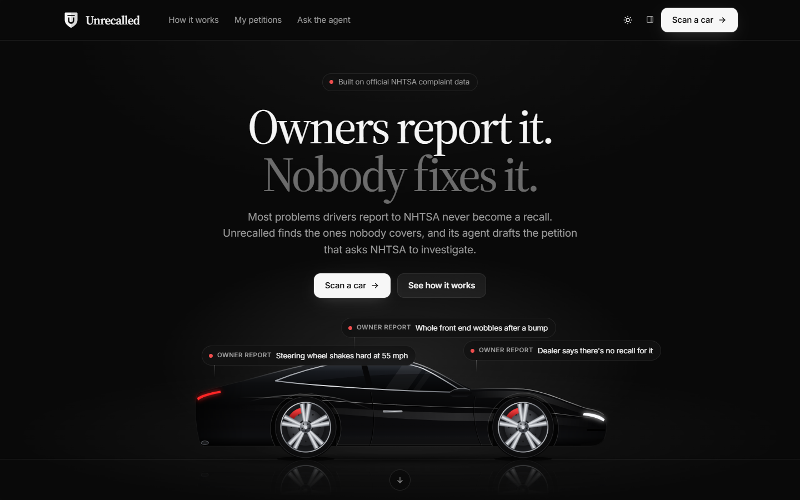

</div>

> [!NOTE]
> **Real data, nothing simulated.** Every complaint, recall and investigation comes live from NHTSA's public APIs and
> flat files. Owner complaints are unverified reports, and grouping them is done by rules you can read and edit, so
> every number in the app can be traced back to complaint IDs.

## At a glance

| | |
| --- | --- |
| **Problem** | NHTSA received **74,369** owner complaints in 2025 and opened **28** defect investigations. Failures that owners keep reporting can sit for years with no recall, no investigation and no warning. |
| **Solution** | Scan any car. Unrecalled groups its complaints into failure modes, checks each model year against every recall, ODI investigation and class settlement, flags what nothing covers, and drafts a 49 CFR Part 552 petition that cites the complaints. |
| **Result** | **2021–23 Jeep Wrangler "death wobble": 380 owner complaints in model years nothing covers**, 248 of them filed after NHTSA closed its investigation without a recall. |
| **Proof** | Backtested on Hyundai/Kia Theta II engine seizure: the same rule the app runs today fires **30 months before the recall**. |
| **Agent-Native** | 23 actions shared by the UI, the in-app agent, HTTP, the CLI and MCP. Corrections become rules. Marking a petition "filed" always asks the human. |

---

## Contents

1. [The problem](#1-the-problem)
2. [What Unrecalled does](#2-what-unrecalled-does)
3. [Results](#3-results)
4. [How it works](#4-how-it-works)
   [Coverage](#41-is-this-failure-covered) ·
   [Early warning](#42-the-early-warning-signal) ·
   [Human in the loop](#43-the-agent-does-the-work-you-make-the-calls) ·
   [Petition](#44-the-petition)
5. [How Unrecalled uses Agent-Native](#5-how-unrecalled-uses-agent-native)
6. [The product](#6-the-product)
7. [Run it](#7-run-it)
8. [Demo in three minutes](#8-demo-in-three-minutes)
9. [Actions, HTTP and CLI](#9-actions-http-and-cli)
10. [Project structure and tech stack](#10-project-structure-and-tech-stack)
11. [Testing](#11-testing)
12. [Who would use it](#12-who-would-use-it)
13. [Honest limits and roadmap](#13-honest-limits-and-roadmap)
14. [Disclosure: pre-existing work](#14-disclosure-pre-existing-work)
15. [Editing the diagrams](#15-editing-the-diagrams)
16. [Sources](#16-sources)

---

## 1. The problem

When a car keeps failing the same way, owners file complaints with NHTSA, the US vehicle safety regulator. A recall
only happens if NHTSA's Office of Defects Investigation (ODI) opens an investigation and finds a defect, or the
carmaker recalls on its own. Most complaints never get that far:

<p align="center">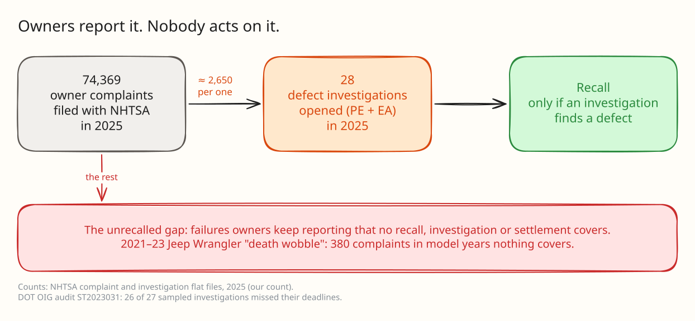</p>

| Fact | Why it matters |
| --- | --- |
| **74,369 complaints, 28 investigations opened (2025)**, from NHTSA's own flat files (our count). | About 2,650 complaints for every investigation. Most patterns are never looked at. |
| **DOT Inspector General audit ST2023031 (May 2023):** 26 of 27 sampled investigations missed their deadlines. Preliminary evaluations averaged 617 days, engineering analyses 1,001. | Even the defects that get investigated wait years. |
| **Investigations close without a recall.** The Jeep "death wobble" probe PE19-012 closed in Oct 2023 and the Tesla phantom-braking probe PE22-002 in Jun 2026, both with no recall. | A closed probe looks like an answer, but owners keep reporting the failure. |
| **Anyone may petition NHTSA** to open an investigation (49 U.S.C. § 30162, 49 CFR Part 552). | The legal path exists. Building the evidence by hand takes days, so owners rarely use it. |
| **Recall checkers only show known recalls.** Carfax, the NHTSA recall lookup and dealers answer "is there a recall?", not "is anyone covering what owners report?". | A dealer saying "there's no recall for that" is where owners give up. |

<details>
<summary><b>New to NHTSA? A 30-second glossary</b></summary>

| Term | Meaning |
| --- | --- |
| **NHTSA** | National Highway Traffic Safety Administration, the US regulator for vehicle safety. |
| **Complaint (ODI number)** | A report an owner files at nhtsa.gov. Each has an 8-digit ODI number, the model year and a free-text story. |
| **Recall** | A carmaker's fix for a safety defect, numbered like `21V846`. |
| **ODI investigation** | NHTSA's own probe: preliminary evaluation (**PE**), engineering analysis (**EA**), recall query (**RQ**) or defect petition (**DP**). |
| **Closed without a recall** | The investigation ended and nobody was required to fix anything. |
| **Settlement** | A class-action deal, such as Reynolds v. FCA, that extends a warranty for some model years without a recall. |
| **49 CFR Part 552** | The regulation that lets anyone petition NHTSA to open a defect investigation. |

</details>

## 2. What Unrecalled does

| # | Capability | What it means for an owner |
| --- | --- | --- |
| 1 | **Scan any car** | Type a make, model and years (or a VIN). Unrecalled pulls every complaint, recall and investigation from NHTSA live. |
| 2 | **Group complaints into failure modes** | 26 failure modes, from death wobble to phantom braking, matched by rules you can read. The matched words are highlighted in each complaint. |
| 3 | **Check coverage, year by year** | Each model year is *recalled*, *under investigation*, *covered by a settlement*, *closed without a recall* or **uncovered**. Every status links to its NHTSA source. |
| 4 | **Early-warning signal** | At least 10 matching complaints and at least 5× the share seen on peer cars. Backtested: 30 months before the Theta II recall. |
| 5 | **Post-recall evidence** | Counts complaints filed more than a year after a matching recall, a sign the fix didn't work or the recall was too narrow. |
| 6 | **Corrections become rules** | Exclude a wrongly grouped complaint or add a word, and every future scan uses it. |
| 7 | **Petition, drafted by the agent** | A 49 CFR 552 petition citing ODI numbers, with a checklist of the regulation's required items, Save as PDF and how to send it. Marking it "filed" needs your approval. |
| 8 | **Watch** | Watched cars are re-checked every week; you get an update when an uncovered problem grows. |

## 3. Results

### 3.1 The demo car: Jeep Wrangler "death wobble"

A violent front-end shake at highway speed, reported by Wrangler owners for years. Unrecalled scanned the 2018–2023
Wrangler: **4,949 owner complaints**, **36 recalls** and **12 investigations** checked. Death wobble has **1,203
complaints**, and **380** of them are in model years nothing covers.

<p align="center">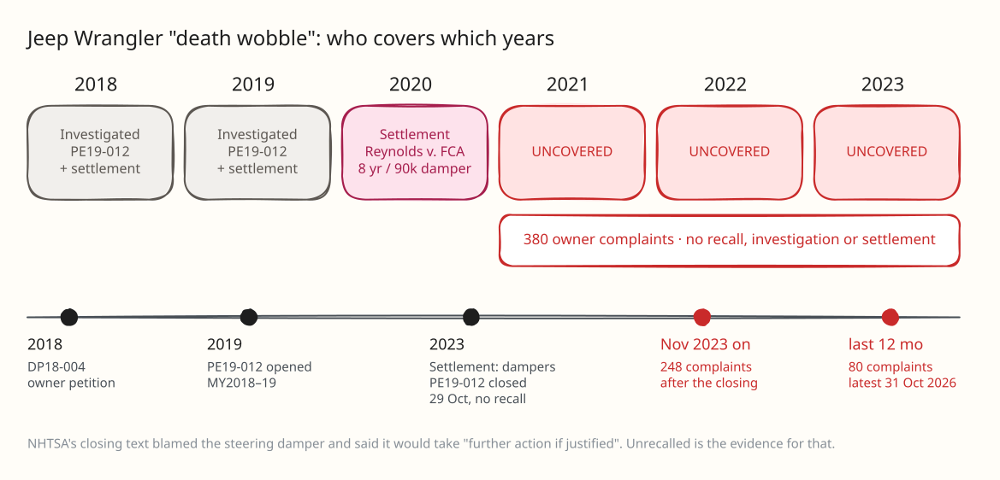</p>

| Measure | Value |
| --- | ---: |
| Death-wobble complaints, MY2018–2023 | 1,203 |
| In model years nothing covers (MY2021–23) | **380** |
| Filed after PE19-012 closed without a recall (29 Oct 2023) | 248 |
| Filed in the last 12 months | 80 (latest 31 Oct 2026) |

PE19-012 itself was opened from an owner petition (DP18-004), the same route Unrecalled automates. Its closing
text blamed the steering damper and said NHTSA would take "further action if justified".

### 3.2 More cars, three different answers

| Car | What Unrecalled found |
| --- | --- |
| **2021 Tesla Model 3**, phantom braking | Covered: recall 21V846 and investigation PE22-002, which closed on 29 Jun 2026 with no recall and 0 crashes found. 55 complaints arrived more than a year after the recall, which is post-recall evidence. |
| **2021–2026 Chevrolet Silverado 1500** | NHTSA's engine probe EA26005 (997,743 vehicles) checks whether a recall fix worked; GM's data is due 13 Nov 2026. Unrecalled counts 71 post-recall complaints on the Silverado 1500. |
| **2019–2020 Honda Civic** | Top uncovered problem: loss of power-steering assist. |

### 3.3 Backtest: would it have caught a real scandal?

<p align="center">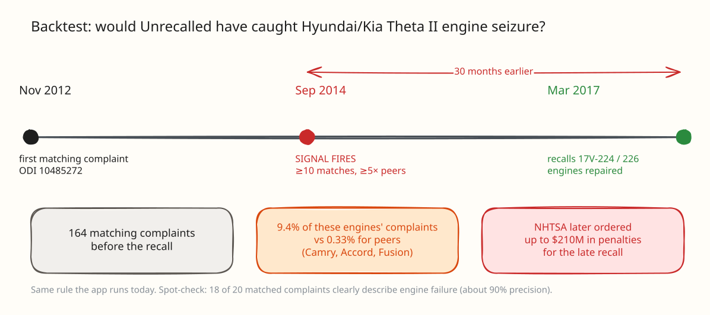</p>

| Measure | Value |
| --- | ---: |
| First matching complaint | 20 Nov 2012 (ODI 10485272) |
| Signal fires (≥10 matches and ≥5× peer share) | **Sep 2014** |
| Recall (17V-224 Hyundai, 17V-226 Kia) | 31 Mar 2017 |
| **Lead time** | **30 months** |
| Matching complaints before the recall | 164 |
| Share of all complaints, Theta II cars vs peers (Camry, Accord, Fusion) | 9.4% vs 0.33% |
| Precision, hand check of 20 random matches | 18 of 20 (about 90%) |

NHTSA later ordered **up to $210M** in civil penalties for the late recall (part of it deferred, and the companies
disputed the findings). The backtest data, patterns and notes are in
[`server/engine/backtest-data/theta2.json`](server/engine/backtest-data/theta2.json).

## 4. How it works

<p align="center">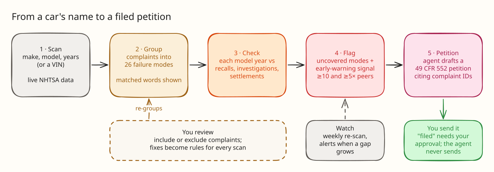</p>

### 4.1 Is this failure covered?

Every model year with complaints gets one status. The strongest one wins: recalled > under investigation >
settlement > closed without recall > uncovered.

<p align="center">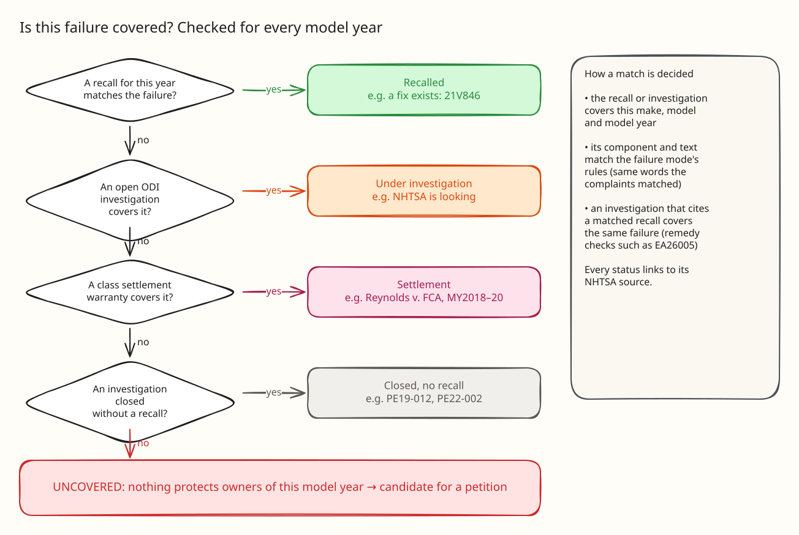</p>

A recall or investigation covers a failure mode only when it names the same make, model and year **and** its
component and text match the mode's rules. That is why a power-steering-pump **fire** recall (26V363) doesn't count
as a death-wobble fix. An investigation that cites a matched recall covers the same failure, which catches remedy
checks such as EA26005. Code: [`server/engine/coverage.ts`](server/engine/coverage.ts).

### 4.2 The early-warning signal

A failure mode fires when it has **at least 10 matching complaints** and its share of the car's complaints is **at
least 5×** the share on peer cars. With no peer baseline, it needs at least 5% of all complaints. The rule is
deliberately simple, so an owner, a journalist or NHTSA can check it by hand. Code:
[`server/engine/signal.ts`](server/engine/signal.ts).

### 4.3 The agent does the work. You make the calls.

<p align="center">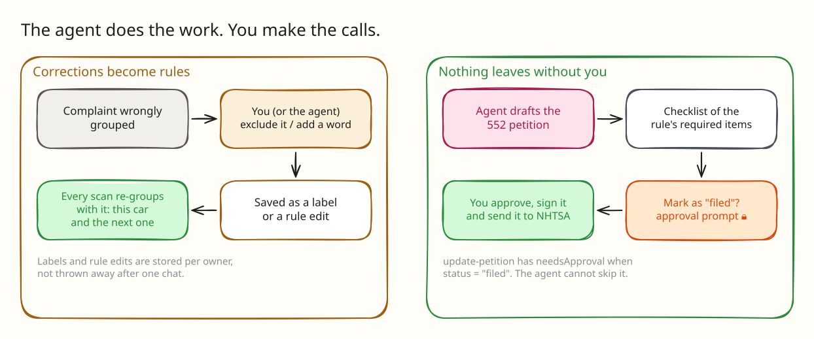</p>

- **Corrections become rules.** Labels and rule edits are stored per owner and apply to every scan, for this car and
  the next one.
- **Nothing leaves without you.** `update-petition` with `status: "filed"` has `needsApproval`, so the agent
  can't skip the prompt. "Ready" and "filed" are refused (409 `checklist_incomplete`) until the 552.4 items are met.
  Unrecalled never sends anything to NHTSA; you do.

### 4.4 The petition

[`server/engine/petition.ts`](server/engine/petition.ts) writes a petition that follows 49 CFR 552.4. It is in
English, has a heading containing "Petition", states the facts and the order requested, gives the petitioner's
name and address, and names 49 U.S.C. 30162 as its basis. It cites:

- the complaint count by model year, with ODI numbers and short quotes
- what each recall and investigation covers, and why it doesn't cover this failure
- the early-warning signal and any post-recall complaints

The petition page shows the checklist, a plain-language "How to send it" with NHTSA's current address, and Save as PDF.

## 5. How Unrecalled uses Agent-Native

<p align="center">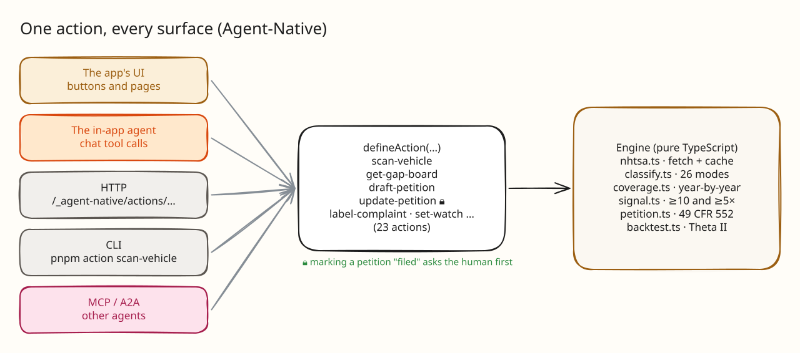</p>

Builder's thesis is "if the UI can do it, the agent can do it". Unrecalled follows it exactly:

| Agent-Native feature | How Unrecalled uses it |
| --- | --- |
| **`defineAction`** | 23 actions. "Scan a car" on the homepage and "scan the 2021 Wrangler" in chat call the same `scan-vehicle`. Each one is also an HTTP endpoint, a CLI command and an MCP tool. |
| **`needsApproval`** | Marking a petition "filed" stops for a human yes, whoever asks. |
| **Application state** | The agent sees which car, problem or petition is on screen, so "draft a petition for this" just works. |
| **Live sync** | When the agent scans, labels or drafts, the open page updates without a reload. |
| **Recurring jobs** | `set-watch` creates one weekly automation per owner (`jobs/unrecalled-watchlist.md`) that runs `rescan-watchlist` and summarises new alerts. |
| **Agent loop, not one prompt** | The agent chains real actions (scan → board → cluster → draft → navigate) and answers only with numbers from action results. |
| **Less AI where it counts** | Grouping, coverage, the signal and the petition checklist are deterministic code. The model reads, explains, drafts and navigates. |

<p align="center">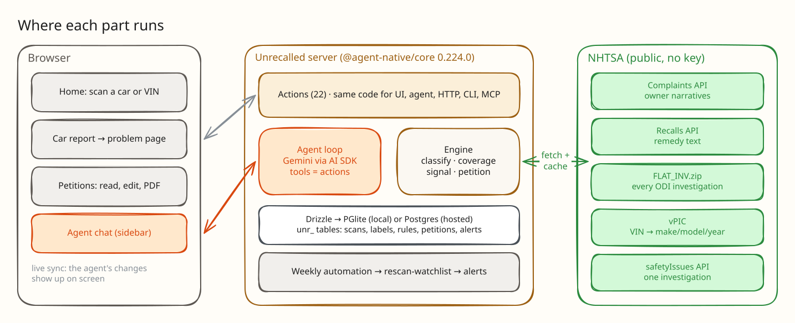</p>

## 6. The product

**Homepage:** the hero, then a scroll story in five stops (Report, Group, Check, Gap, Petition) and the scan form.

| | |
| :---: | :---: |
|  | 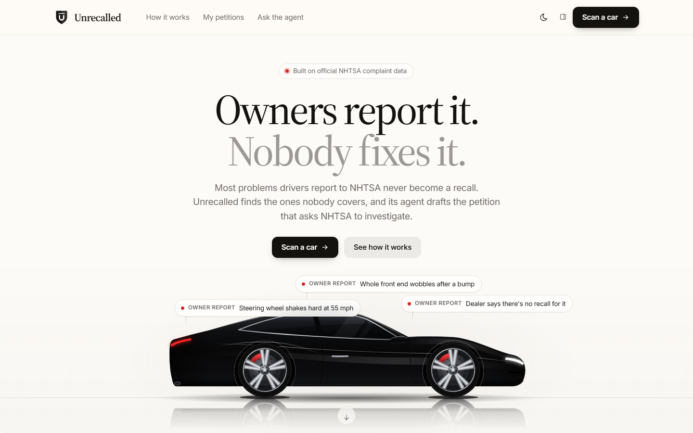 |
| Dark | Light |

**The car report.** One page per car: how many problems have years nothing covers, the agent's summary, and the
weekly watch.

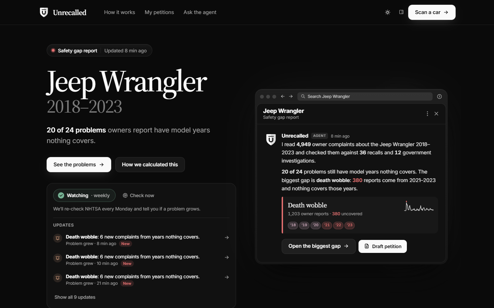

**The problem page.** For death wobble: uncovered, early warning since Nov 2018, 1,203 reports, the monthly trend,
year-by-year coverage linked to each recall and investigation, and the complaints with the matched words highlighted.

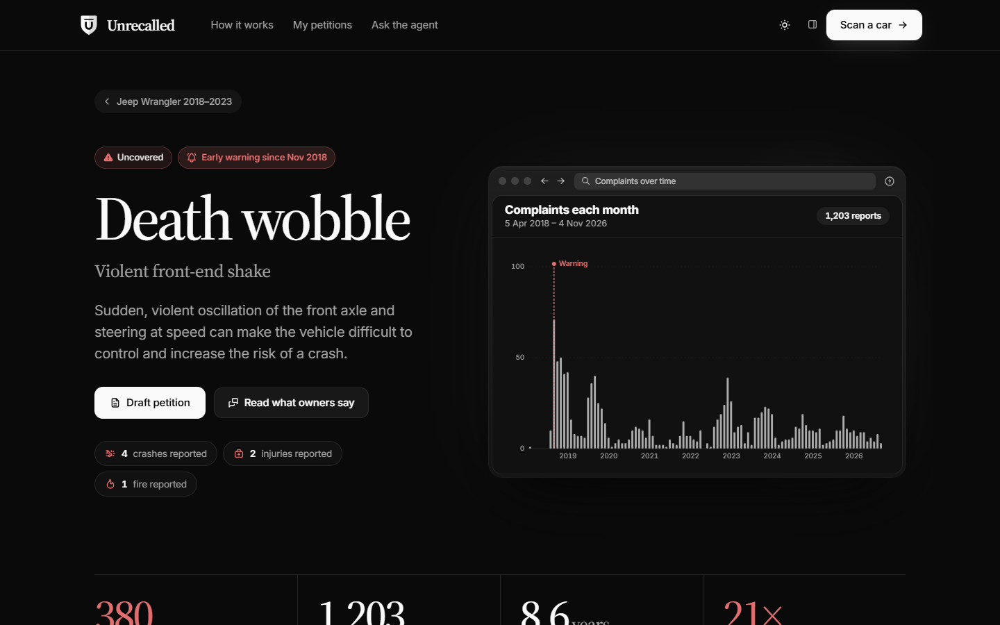

**The petition.** Drafted by the agent, edited by you, checked against 49 CFR 552.4, saved as PDF.

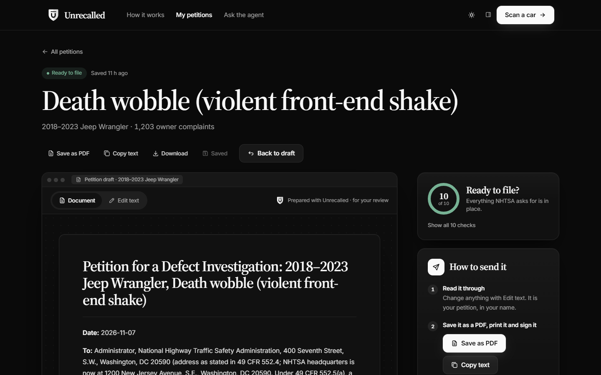

| | |
| :---: | :---: |
| 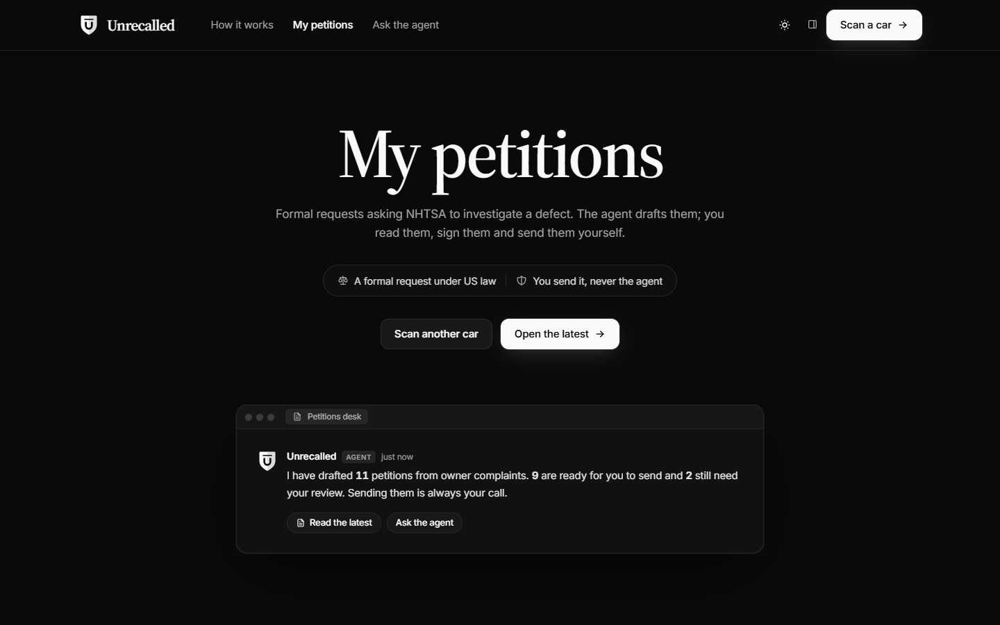 | 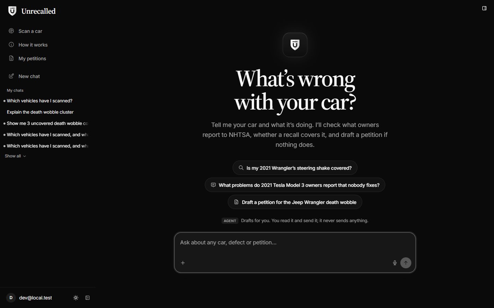 |
| My petitions: drafts, ready, filed | Ask the agent |
| 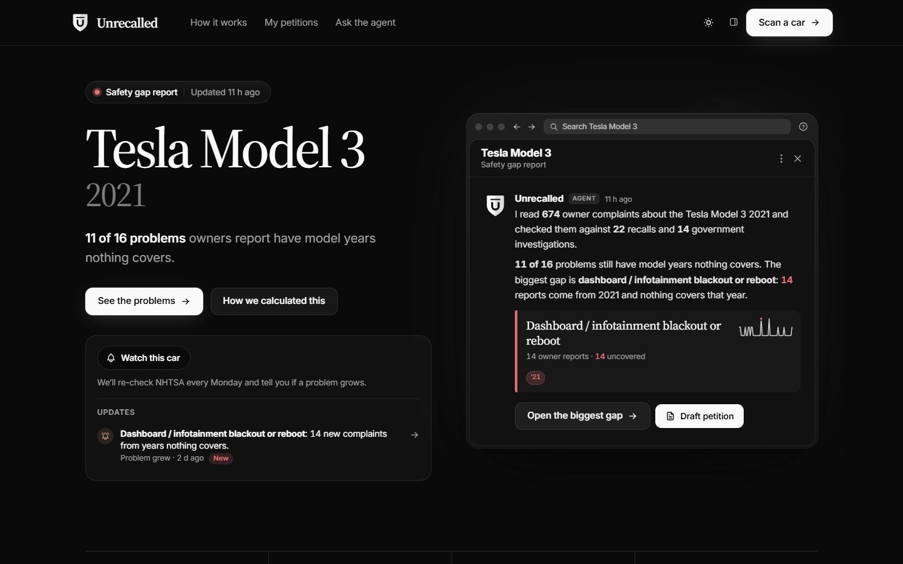 | 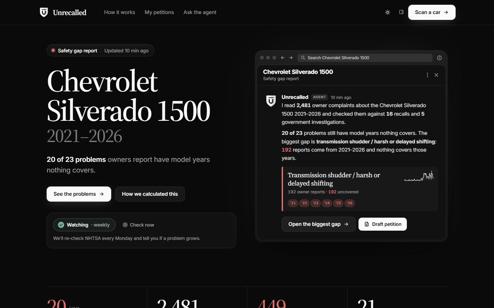 |
| Tesla Model 3 2021 | Chevrolet Silverado 1500 2021–2026 |

<details>
<summary><b>Light mode</b></summary>

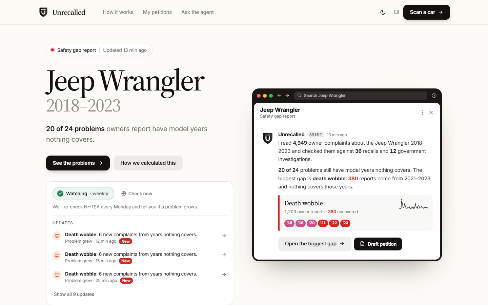
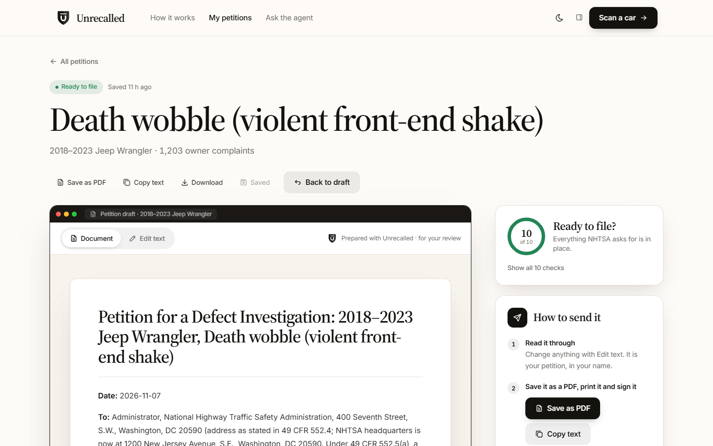

</details>

## 7. Run it

Needs **Node ≥ 22.22** and **pnpm**.

```bash
pnpm install
pnpm dev          # http://localhost:8080 → "Continue as local dev"
```

`pnpm dev` stores data in a local PGlite database under `data/`, so nothing else is needed. The first load after
starting takes about 20 seconds while Vite compiles.

**The agent chat** needs an LLM key in `.env`. Tested with Gemini:

```bash
GOOGLE_GENERATIVE_AI_API_KEY=...
AGENT_ENGINE=ai-sdk:google
AGENT_MODEL=gemini-3.5-flash
```

Providers with a small tokens-per-minute cap, such as the Groq free tier (8k TPM), are too small: one car report is
about 20k tokens.

**Hosting.** `pnpm build` and `pnpm start` need a hosted Postgres `DATABASE_URL`; the production server refuses
local PGlite.

## 8. Demo in three minutes

1. Open the homepage and scroll the five-stop story.
2. **Scan a car:** Jeep, Wrangler, 2018–2023. The report says 20 of 24 problems have years nothing covers.
3. Open **death wobble**: 2018–19 investigated, 2020 settlement, 2021–23 uncovered, 380 complaints, each linked to
   its ODI number.
4. Exclude a complaint that doesn't fit. The counts update, and the rule carries over to the next scan.
5. **Draft petition.** The agent writes it; the checklist turns green.
6. Ask the agent to mark it filed. The approval prompt appears; the agent can't skip it.
7. Turn on **Watch**: every Monday you get an update if the problem grows.

## 9. Actions, HTTP and CLI

| Action | What it does |
| --- | --- |
| `scan-vehicle` | Fetch complaints, recalls and investigations for a make, model and up to 8 model years; group and check coverage |
| `decode-vin` | VIN → make, model, year (vPIC) |
| `list-vehicles`, `get-gap-board` | Scanned cars; ranked problems for one car |
| `get-cluster` | One problem: rule, coverage sources, complaints page |
| `label-complaint` | Include or exclude a complaint (carries over to every scan) |
| `list-failure-modes`, `update-failure-mode`, `create-failure-mode` | Read and edit the grouping rules |
| `add-settlement` | Record a settlement that covers some model years |
| `draft-petition`, `get-petition`, `update-petition`, `list-petitions` | The 552 petition (`filed` needs approval) |
| `get-backtest` | The Theta II backtest |
| `set-watch`, `rescan-watchlist`, `list-alerts`, `mark-alerts-seen` | Weekly watch, its updates, and marking them seen |

Every action is also an HTTP endpoint and a CLI command:

```bash
pnpm action scan-vehicle --make JEEP --model WRANGLER --yearFrom 2018 --yearTo 2023
pnpm action get-gap-board --vehicleId <id>
pnpm action draft-petition --vehicleId <id> --failureModeId death-wobble
```

HTTP: `POST /_agent-native/actions/<name>` (signed-in session). `get-gap-board` and `decode-vin` also accept `GET`.

## 10. Project structure and tech stack

```
unrecalled/
├── actions/                 ← 23 actions: one capability each, shared by UI, agent, HTTP, CLI, MCP
├── server/
│   ├── engine/              ← pure TypeScript, no framework imports
│   │   ├── nhtsa.ts         ←   complaints, recalls, FLAT_INV.zip, vPIC (+ cache.ts)
│   │   ├── rules.ts         ←   26 failure modes + known settlements
│   │   ├── classify.ts      ←   rules → clusters, matched words
│   │   ├── coverage.ts      ←   per-year status: recalled … uncovered
│   │   ├── signal.ts        ←   ≥10 matches and ≥5× peers
│   │   ├── petition.ts      ←   49 CFR 552 petition + 552.4 checklist
│   │   ├── backtest.ts      ←   Theta II backtest (data in backtest-data/)
│   │   └── __tests__/
│   ├── db/schema.ts         ← Drizzle tables (unr_ prefix)
│   ├── lib/                 ← owner scoping, petitions, modes
│   └── plugins/             ← DB, agent chat, branded sign-in
├── app/
│   ├── routes/              ← / (home), /gaps/:car, /gaps/:car/:problem, /petitions, /chat
│   └── components/unrecalled/  ← report, problem page, petition editor, scan form, landing
├── scripts/                 ← backtest and validation scripts
├── docs/
│   ├── diagrams/            ← the diagrams above, as .svg and editable .excalidraw
│   └── screenshots/
└── vite.config.ts, vite.tabler-shim.ts  ← dev-speed fixes (see below)
```

| Layer | Tech |
| --- | --- |
| Framework | `@agent-native/core` 0.224.0 (pinned), chat template |
| Front end | React Router 8, Vite 8, Tailwind 4, Source Serif 4 + Inter, Tabler icons |
| Data | Drizzle ORM on PGlite (local) or Postgres (hosted) |
| Agent | AI SDK, Gemini (`gemini-3.5-flash`), tools = the app's actions |
| Data sources | NHTSA complaints, recalls, ODI investigations flat file, safetyIssues, vPIC: public, no key |

**Dev speed.** In dev mode the framework served every page about 140 MB of code and inline sourcemaps, plus all 6,000
icons. [`vite.config.ts`](vite.config.ts) drops dependency sourcemaps and pre-bundles the heavy libraries, and
[`vite.tabler-shim.ts`](vite.tabler-shim.ts) serves only the icons the app uses. Reloads went from 13–41 s to under
2 s. Production builds are unaffected.

## 11. Testing

```bash
pnpm test                 # 102 unit tests on the engine
LIVE=1 pnpm test          # + 6 live tests against the NHTSA APIs
pnpm typecheck
pnpm agent-native:doctor
```

| Suite | Checks |
| --- | --- |
| `coverage.test.ts` | Year-by-year precedence; a recall covers only its own model year; a component label alone doesn't count as coverage; remedy-check investigations that cite a matched recall |
| `rules.test.ts` | Real recall text: 18V675 (track-bar welds) isn't death wobble, 22V317 and 24V153 aren't phantom braking; Reynolds v. FCA covers 2018–20 Wrangler |
| `classify.test.ts` | Include and exclude patterns; your labels override the rules both ways; matched-word highlights |
| `signal-scan.test.ts` | Fires at the first month both thresholds hold; 5% fallback with no peers; post-recall counts after 365 days |
| `petition.test.ts` | Every 552.4 element; ODI citations; the checklist flags a missing name, address or facts |
| `alerts.test.ts` | Watch alerts only when an uncovered problem gains 5+ complaints or a signal newly fires |
| `backtest.test.ts` | Theta II fires before the recall with a positive lead |
| `live.test.ts` | Real NHTSA responses: ~961 2021 Wrangler complaints, DD/MM recall dates, investigations, VIN decoding (skipped unless `LIVE=1`) |

The grouping rules were also checked by hand: about 90–100% precision on samples of the top failure modes
(`scripts/validate-rules.ts`, `scripts/validate-coverage.ts`).

## 12. Who would use it

| Who | What they get |
| --- | --- |
| **Owners** | "The dealer says there's no recall." Now they can see whether anyone is covering the problem, and send a petition with the evidence attached. |
| **Safety advocates** (such as the Center for Auto Safety) | They count complaints by hand to build petitions today. Unrecalled does the counting and drafting. |
| **Journalists** | A sourced, reproducible number with ODI citations, before the recall. |
| **NHTSA analysts** | A ranked list of uncovered failure modes with the evidence already grouped. |
| **Lawyers and insurers** | Year-by-year coverage that shows who is protected and who isn't. |

## 13. Honest limits and roadmap

- **Complaints are unverified.** They are owner reports, not proof of a defect. Unrecalled shows evidence; NHTSA decides.
- **Rules, not magic.** Grouping is keyword rules. Rare phrasings are missed and some matches are wrong, so you can
  exclude complaints and edit rules.
- **Settlements aren't in any NHTSA feed.** Known ones are seeded (Reynolds v. FCA) and you can add others with
  `add-settlement`.
- **The backtest is one case.** Theta II shows the rule can work. It is not a measured false-alarm rate across
  every recall.
- **Different counts.** Earlier research counted about 407 uncovered Wrangler complaints and a 27-month lead. The
  app's live scan, with tighter rules and a different peer set, gives 380 and 30 months. The README uses the app's
  numbers.
- **Not hosted yet.** A public deploy needs hosted Postgres.
- **Roadmap:** check a used car from its VIN before you buy; group petitions so many owners can co-sign; email alerts
  for watched cars; a measured backtest across many recalls; Canada (Transport Canada) data.

## 14. Disclosure: pre-existing work

- **From the Agent-Native "chat" template** (`agent-native create --template chat`): the app shell, auth, chat UI,
  layout, `app/components/ui/*`, `.agents/` skills, the framework plugins and the template actions `navigate`,
  `view-screen`, `run` and `provider-api-request`.
- **Built for this hackathon:**
  - `server/engine/**`: NHTSA ingestion, classifier, coverage, signal, backtest and petition
  - `server/db/**`, `server/lib/**` and `server/plugins/db.ts`
  - every other file in `actions/`
  - the Unrecalled routes and `app/components/unrecalled/**`
  - the branded sign-in, the dev-speed fixes and these docs
- **Prior art:** ProblemsByVin also publishes a recall-gap index. Unrecalled differs in modelling investigation,
  settlement and remedy coverage per model year, in corrections that carry over, in the backtest and in the
  petition workflow.

## 15. Editing the diagrams

Every diagram here was drawn with [Excalidraw](https://excalidraw.com). The editable sources sit next to the exported
SVGs in [`docs/diagrams/`](docs/diagrams). Open a `.excalidraw` file at excalidraw.com (menu → Open), edit it, then
export it as SVG over the old file.

| Diagram | File |
| --- | --- |
| The unrecalled gap | `01-the-gap.excalidraw` |
| How it works | `02-how-it-works.excalidraw` |
| Coverage rules | `03-coverage-rules.excalidraw` |
| One action, every surface | `04-one-action.excalidraw` |
| Where each part runs | `05-architecture.excalidraw` |
| The Wrangler story | `06-wrangler.excalidraw` |
| Theta II backtest | `07-backtest.excalidraw` |
| Human in the loop | `08-human-loop.excalidraw` |

## 16. Sources

**Data (public, no key)**
- NHTSA complaints API: https://api.nhtsa.gov/complaints/complaintsByVehicle?make=JEEP&model=WRANGLER&modelYear=2021
- NHTSA recalls API: https://api.nhtsa.gov/recalls/recallsByVehicle?make=JEEP&model=WRANGLER&modelYear=2021
- ODI investigations flat file: https://static.nhtsa.gov/odi/ffdd/inv/FLAT_INV.zip (spec: https://static.nhtsa.gov/odi/ffdd/inv/INV.txt)
- Complaint flat files: https://static.nhtsa.gov/odi/ffdd/cmpl/
- vPIC VIN decoder: https://vpic.nhtsa.dot.gov/api/

**The problem**
- DOT OIG audit ST2023031 (31 May 2023): https://www.oig.dot.gov/sites/default/files/NHTSA%20ODI%20Final%20Report_5.31.23.pdf
- GAO-11-603: https://www.gao.gov/products/gao-11-603
- 49 CFR Part 552: https://www.ecfr.gov/current/title-49/subtitle-B/chapter-V/part-552
- 49 U.S.C. § 30162: https://www.law.cornell.edu/uscode/text/49/30162

**The cases**
- Tesla PE22-002 closing summary (29 Jun 2026): https://static.nhtsa.gov/odi/inv/2022/INCLA-PE22002-25796.pdf
- Jeep death-wobble settlement (Reynolds v. FCA): https://thedrive.com/news/jeep-agrees-to-settlement-over-wrangler-gladiator-death-wobble
- Hyundai/Kia Theta II consent orders: https://www.nhtsa.gov/press-releases/nhtsa-announces-consent-orders-hyundai-and-kia-over-theta-ii-recall
- RQ17-003 closing: https://static.nhtsa.gov/odi/inv/2017/INCLA-RQ17003-1265.PDF

**Related work**
- ProblemsByVin Recall-Gap Index: https://problemsbyvin.com/data/
- DrivePulse / Georgetown, ESV 2026: https://static.nhtsa.gov/esv/pdf/ESV/Proceedings/28/ESV26-289.pdf
- Center for Auto Safety petitions: https://www.autosafety.org/

**The framework**
- Agent-Native docs: https://www.agent-native.com/docs/what-is-agent-native
- How to build agent-native apps (Steve Sewell): https://www.builder.io/blog/agent-native-apps
